<p align="center"></p>

<h1 align="center">D.C. O'HAIR</h1>
<p align="center"><i>Data City Over Here Am I Right?</i></p>

<p align="center"><sub><i>"It's a UNIX system! I know this!"</i></sub></p>

<p align="center"><b>A usable, good, easy, network-wide, large-scale, fsv-style, lovable disk city.</b></p>

D.C. O'HAIR turns the drives on all your computers into one 3D city you can fly through.

Each device is a district, each drive is a block, and each big file or folder is a building. The buildings are colored by what's inside: Music, Games, Series, Movies and Other. Next to the city is a plain table of every drive: Used, Free, Total, and how much of each category it holds.

It's for anyone with a few machines and a pile of disks: a media server, a gaming PC, a laptop or two. It answers the question "where did all my space go?" for all of them at once.

<p align="center">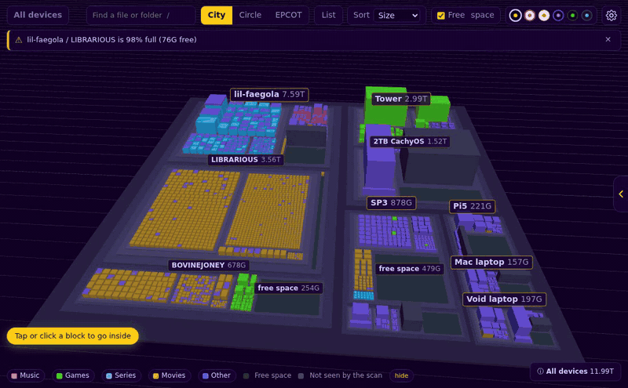</p>

- **Read-only.** It never deletes, moves or changes a file on any device.
- **Nothing to install on your devices.** The hub sends a small Python script over SSH and reads the answer. The device only needs `python3`.
- **Self-hosted.** It's one small Python service plus a web page. No cloud and no account.

---

## Contents

- [Quick start](#quick-start)
- [Try it without your data](#try-it-without-your-data)
- [First-run setup, step by step](#first-run-setup-step-by-step)
- [A tour of the city](#a-tour-of-the-city)
- [How it works](#how-it-works)
- [Configuration](#configuration)
- [JSON API](#json-api)
- [Roadmap](#roadmap)
- [Contributing](#contributing)
- [License](#license)

---

## Quick start

Pick one of the two ways below. Either way, you then open **http://your-hub:7171** and a setup wizard walks you through the rest.

### Docker

```sh
git clone https://github.com/nviiiivn/dc-ohair.git
cd dc-ohair
mkdir -p config data   # your settings and your scans live here
docker compose up -d
```

Then open http://localhost:7171 (or the machine's address).

The compose file mounts the host's filesystem **read-only** at `/hostfs`, so the hub can scan the machine it runs on. Your settings live in `./config/devices.yml`, and scan results and the hub's SSH key live in `./data`.

### Bare metal (Linux, with systemd)

Download the installer, **read it**, then run it:

```sh
git clone https://github.com/nviiiivn/dc-ohair.git
cd dc-ohair
less install.sh        # read it first; it's short
./install.sh
```

`install.sh` makes a Python virtual environment, installs the two small dependencies (PyYAML, and argon2-cffi for the optional login), and sets up a systemd service. If [gum](https://github.com/charmbracelet/gum) is installed, it runs a friendly terminal wizard. Otherwise it asks plain questions.

Prefer to do it by hand? Two commands:

```sh
python3 -m pip install -r requirements.txt
python3 hub.py
```

Full details, including systemd, a reverse proxy, and adding devices over SSH: **[docs/setup.md](docs/setup.md)**.

> Please don't pipe any install script straight from the internet into a shell, this one included. Download it, read it, then run it.

---

## Try it without your data

```sh
python3 hub.py --demo
```

Open http://localhost:7171. Demo mode shows a made-up home network: a media NAS, a desktop, a laptop, a MacBook and a Pi. Everything works, including settings and the setup wizard, but nothing is saved and nothing on your machine is scanned.

To see the setup wizard in demo mode, open http://localhost:7171/#setup.

---

## First-run setup, step by step

The first time you open the page, with no devices set up yet, the wizard starts by itself. You can skip it, and you can run it again any time from **Settings → Devices → Run the setup wizard**.

<p align="center">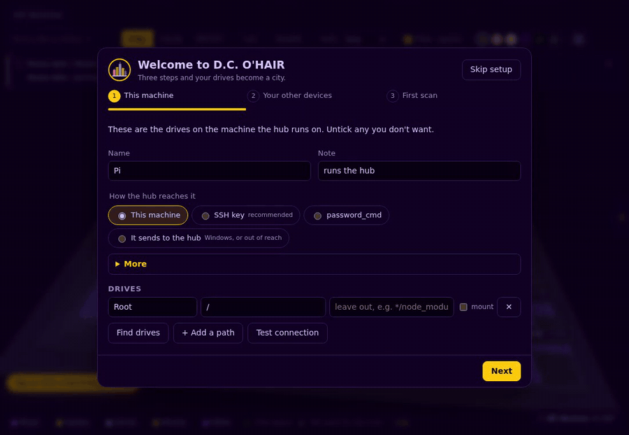</p>

### Step 1: This machine

The hub finds the drives on the machine it runs on. It hides system and pseudo filesystems (like `/proc`, `/boot` and Docker's own layers) and shows each real drive with its size.

- Untick anything you don't want scanned.
- A Windows drive that shows as **read-only** is normal when Windows is hibernated or has Fast Startup on. Reading is all the hub needs.
- On **exFAT** drives, unfinished downloads count at their full size, because exFAT doesn't do sparse files.

<p align="center">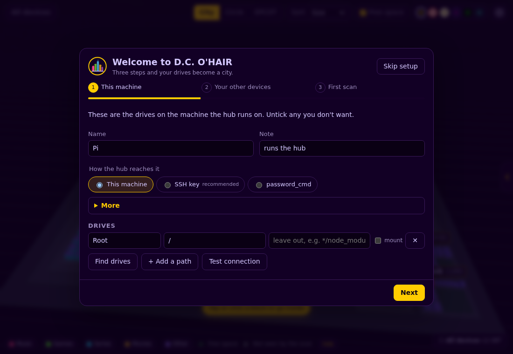</p>

### Step 2: Your other devices

Add each computer or box you want in the city. For each one, give it a name, a host (an IP address or a name like `nas.local`) and a user.

Press **Find devices on my network** to have the hub knock on the SSH and file-sharing ports of the machines around it (only when you ask, and only on your own private network). You get a yes/no checklist with names, open ports and a guess at what each one is; tick the ones to add, or press **+ Add your own** for anything it missed.

<p align="center">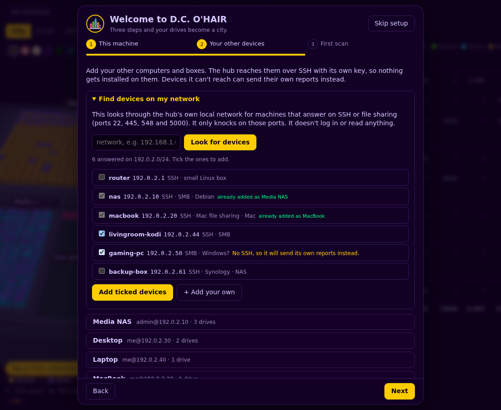</p>

Then let the hub in. The hub has **its own SSH key**, and the wizard shows two ways to add it to the device:

1. **Easiest:** run the `ssh-copy-id` line it shows you **on the hub**. It asks for the device's password once.
2. **Tighter:** run the `authorized_keys` line it shows you **on the device**. The key it adds can only run D.C. O'HAIR's read-only scanner and nothing else. It gets no shell, no port forwarding and no terminal.

Press **Find drives** to list the device's drives, and **Test connection** to check everything. If something's wrong, the message tells you what to do in plain words. For example: "The device turned the hub's key away. Add the hub's key to the device…" or "python3 isn't installed on nas.local…".

<p align="center">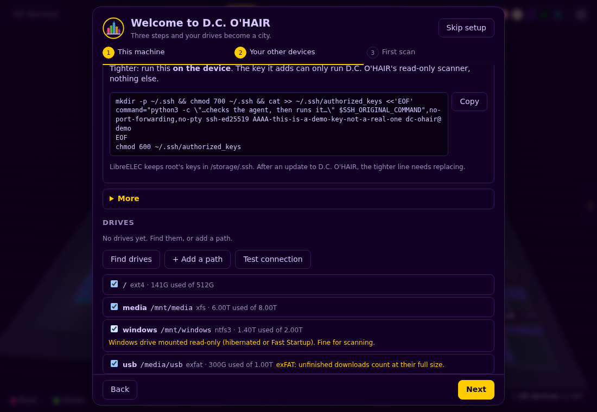</p>

Can't reach it over SSH at all, or it's Windows? Choose **It sends to the hub**. You get one command to paste on the device (a PowerShell line for Windows), and the page waits until the device reports in. See [docs/setup.md](docs/setup.md#devices-the-hub-cant-reach-the-push-agent).

<p align="center">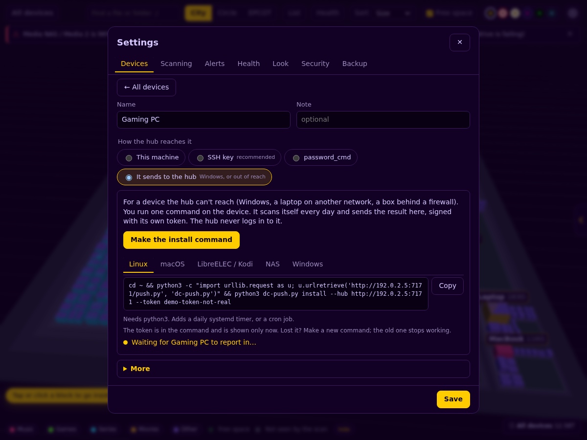</p>

Can't use a key? Choose **password_cmd** instead. That's a command the hub runs at scan time to *print* the password, such as a password-manager lookup. The password is never saved. See [docs/security.md](docs/security.md).

### Step 3: First scan

The hub saves your settings and scans every device. You can watch each one go from *waiting* to *scanning* to *done*. Then press **Open the city**.

<p align="center">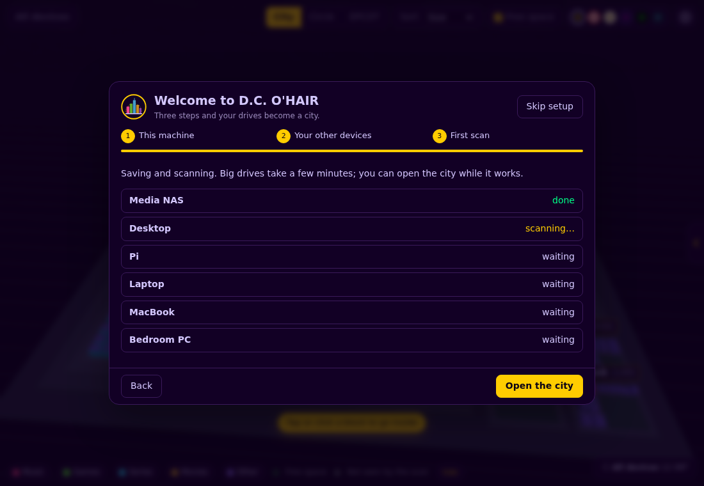</p>

Big drives take a few minutes. After that, the hub rescans every day at 04:30, or whenever you press **Scan now**.

---

## A tour of the city

### Three ways to look at it

<p align="center">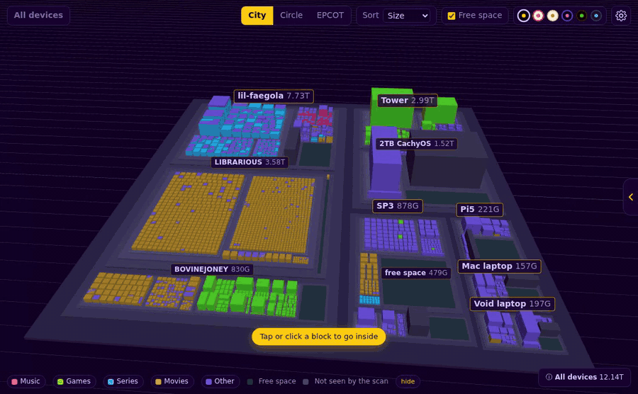</p>

| | |
|---|---|
| **City** | A nested treemap, like fsv's MapV. Each folder is a raised block, and each file is a tower stacked by category. A building's footprint shows its size. |
| **Circle** | Rings of platforms around the folder you're in, like fsv's TreeV. Each ring is one level deeper. |
| **EPCOT** | The hub sits in the middle as a mainframe. Devices sit on a ring around it, joined by glowing beams with data packets flowing in, and every drive is a little round village of its folders and files. |

<p align="center">
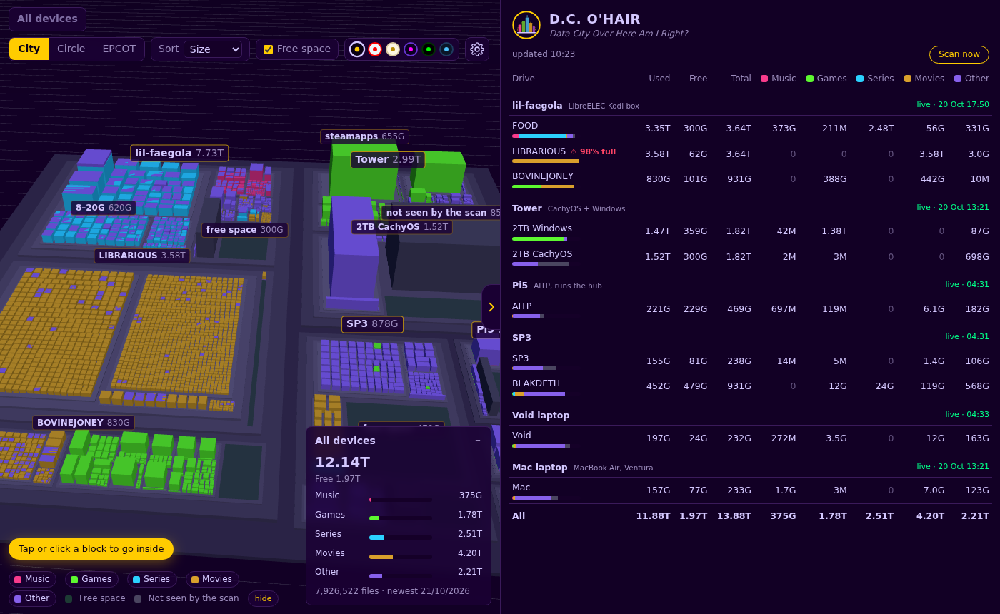
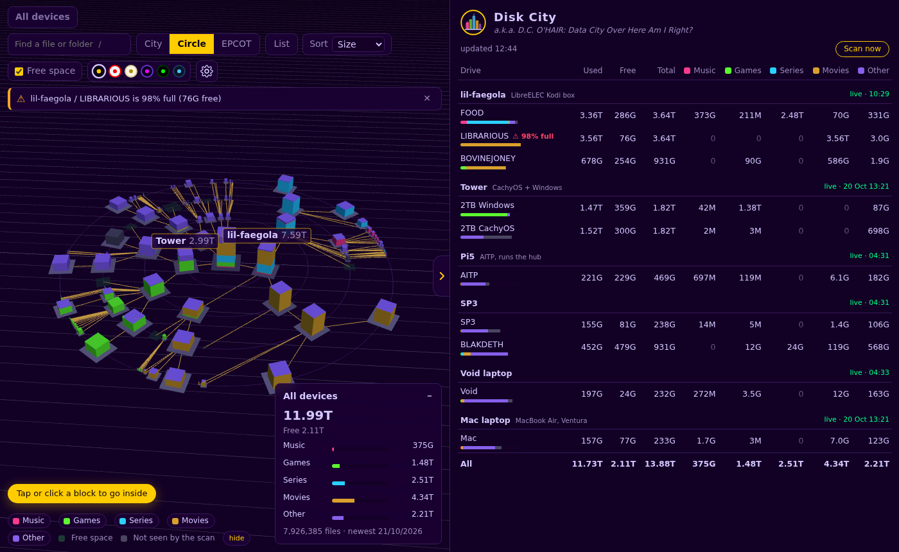
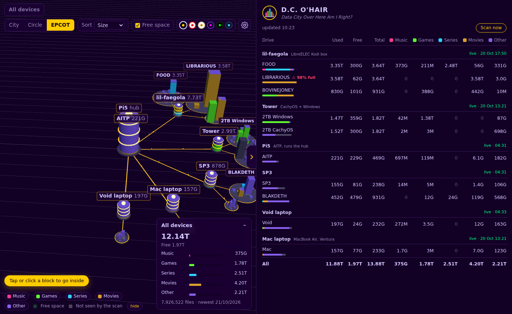
</p>

### Going inside

**Tap or click a block to go one level in.** From the whole city, a tap takes you into that device, then the drive, then the folder. The path is shown along the top, and **Back** (or **Esc**) takes you up a level.

<p align="center"></p>

| To | Mouse / keyboard | Touch |
|---|---|---|
| Look around | drag | one-finger drag |
| Zoom | scroll wheel | pinch |
| Pan | right-drag | two-finger drag |
| Fly | W A S D, Q/E for down/up, Shift for faster | (none) |
| Go inside | click a block | tap a block |
| Go back up | Esc, Backspace, or **Back** | **Back** |

Hover over anything (with a mouse) to see its name, path, size, categories, number of files and newest change. On a tablet, tap a file to see the same details in the info card. The card can be shrunk to a single line with **–**.

Every file of 50 MB or more gets its own building, so a folder of a thousand movies is a thousand buildings. When a folder has more than 120 items, they're grouped into blocks so you can find your way: by first letter, by year, or by size band, depending on the sort.

### Sort

**Type**, **Size**, **Newest**, **Oldest** or **Name**. *Type* groups each folder into Music, Games, Series, Movies and Other districts.

### Filter by category

The color key at the bottom is also a filter. **Tap a chip** to hide or show that category everywhere: every device, every drive. **Double-tap a chip** to show only that one, like "only Series, everywhere". The table follows the filter too. **Show all** brings everything back.

<p align="center"></p>
<p align="center">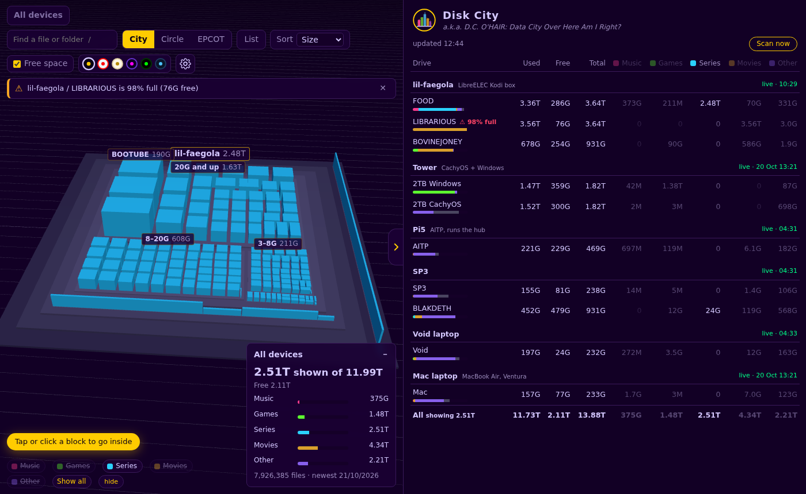</p>

### Free space and blind spots

- **Free space** shows up as flat, empty lots on each drive. Turn it off with the *Free space* checkbox.
- **Not seen by the scan** is space the drive reports as used but the scan couldn't count, such as folders the scanning user isn't allowed to read.

### The drive table

The side pane lists every drive: **Used**, **Free**, **Total**, then **Music**, **Games**, **Series**, **Movies** and **Other**. Under each drive name there's a little bar showing what fills it, and a sparkline of how its used space changed over the last 90 days. A drive that's over the alert line (90% by default) gets a **⚠ 95% full** marker. Tap a row to fly to that drive.

Hide the pane with the tab on its edge, and bring it back the same way. On a phone or narrow screen, the pane sits under the city instead.

<p align="center">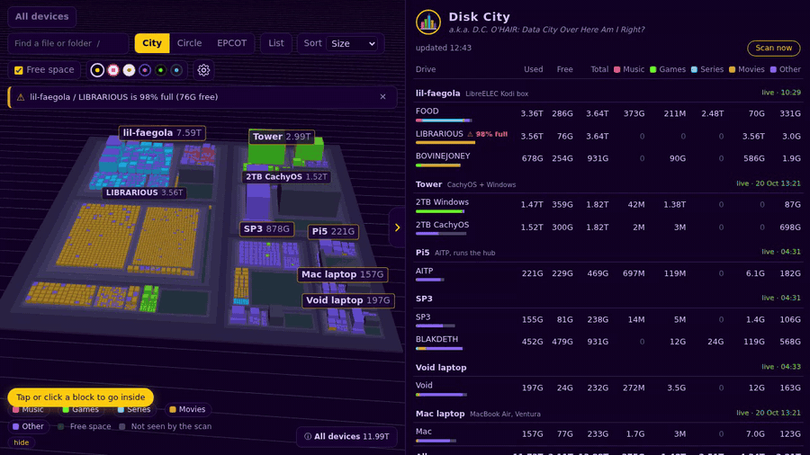</p>

### Themes

There are six themes: dark, light, sepia, cyberpunk, matrix and ocean. The whole scene follows the theme: sky, ground, grid, labels and the building colors. Each theme has its own five category colors, checked so they stay easy to tell apart for people with common kinds of color blindness.

<p align="center">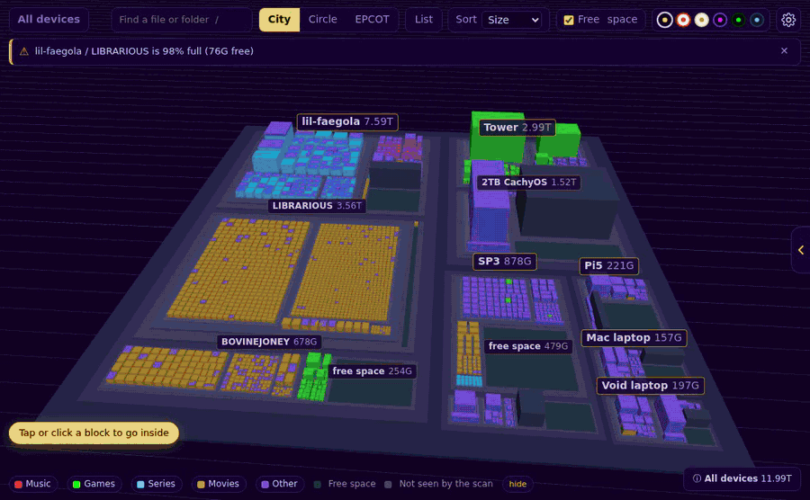</p>
<p align="center">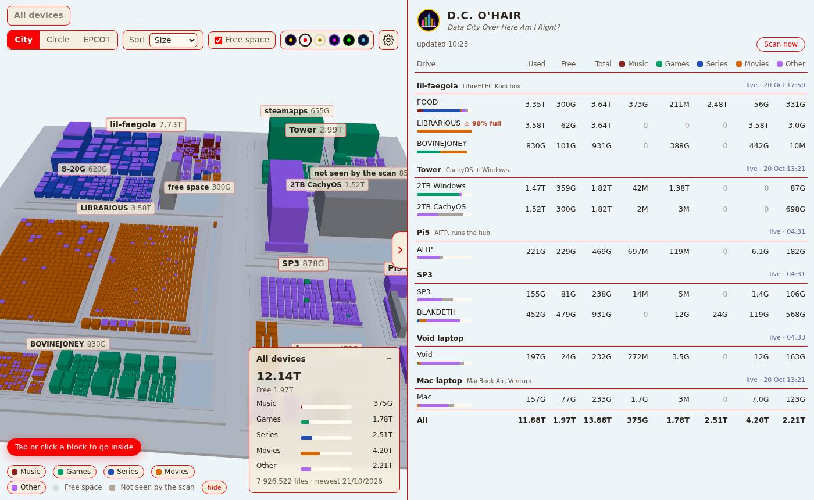 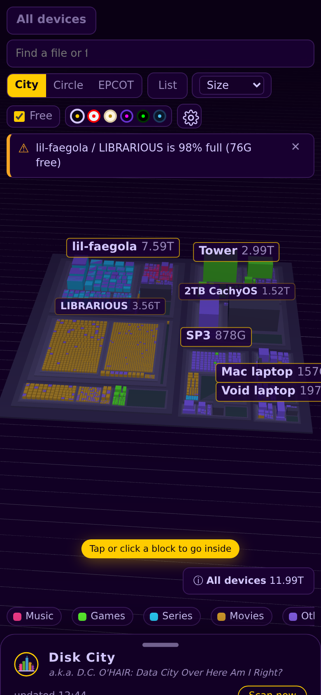</p>

If you run other sites on the same domain, the theme can follow a shared cookie, so picking a theme on one site changes it here too. See `hub.theme` in [docs/configuration.md](docs/configuration.md).

### Settings

Press the gear to open Settings:

| Tab | What's there |
|---|---|
| **Devices** | Add, edit and remove devices, find their drives, test the connection, scan now. Each drive can have "leave out" patterns like `*/node_modules`. |
| **Scanning** | Scan times, the smallest file or folder to draw, folder depth, how long to keep history, and the rules for what counts as Music, Games, Series and Movies. |
| **Alerts** | The "almost full" line, and an optional URL to notify (an ntfy topic works as-is). |
| **Look** | The default theme, view and units for people who haven't picked their own. |
| **Security** | Who can open the page: anyone, an admin login, or your reverse proxy. |
| **Backup** | Export and import the config. |

<p align="center">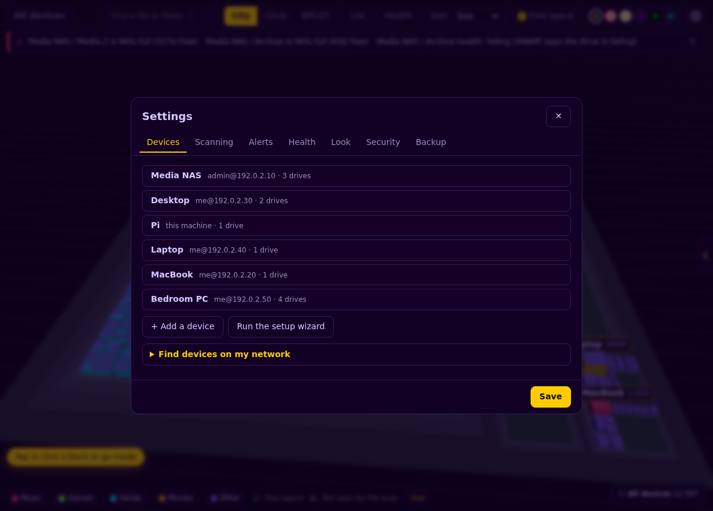</p>
<p align="center">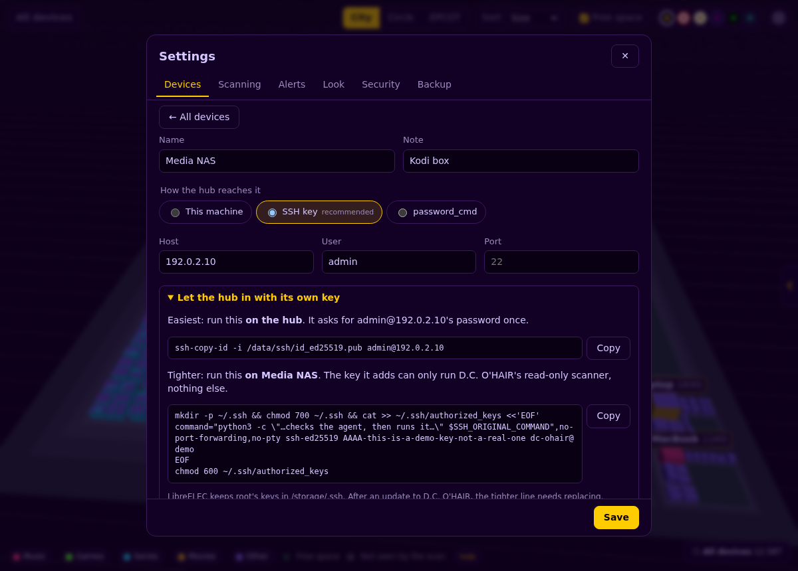</p>
<p align="center"></p>

---

## How it works

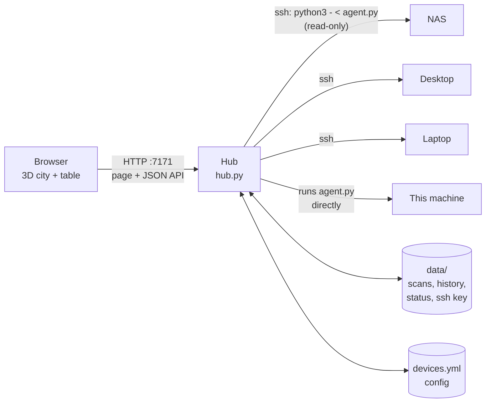

- **The hub** (`hub.py`) is a small Python web server. It serves the page and the JSON API, runs the scheduled scans, and keeps everything in plain files: your config in `devices.yml`, and results in `data/`.
- **The agent** (`agent.py`) is one Python file with no dependencies. For a remote device, the hub runs `ssh device python3 -` and pipes the agent in, so nothing is installed or left behind. The agent walks the drives you chose, sorts files into categories, and sends back a size tree.
- **It only reads.** The agent lists folders and reads file sizes and dates. It doesn't open your files' contents, and it never writes anything on the device.
- It counts hard links once, stops at other filesystems (and knows that btrfs subvolumes aren't other filesystems), and skips btrfs `.snapshots`.

---

## Configuration

Most people never touch the config file, because Settings and the wizard write it for you. It's plain YAML in `devices.yml`, which git ignores:

```yaml
hub:
  port: 7171
  schedule: ["04:30"]      # daily scan times; keep the quotes
  alert_percent: 90

devices:
  - id: hub
    name: Home server
    local: true
    drives:
      - {name: System, path: /, exclude: ["/var/lib/docker"]}

  - id: nas
    name: Media NAS
    ssh: admin@192.0.2.10
    drives:
      - {name: Movies, path: /mnt/movies, mounted: true}
```

Every option is explained in **[docs/configuration.md](docs/configuration.md)**. A fuller example is in [`devices.example.yml`](devices.example.yml).

---

## JSON API

Everything the page shows comes from a JSON API, and it's meant to stay stable so other tools, and later phone apps, can use it. When a login is on, send the session cookie from `/api/login`. Every `POST` or `PUT` needs the header `X-DC: 1`.

| Method | Path | What it does |
|---|---|---|
| GET | `/api/me` | Login state, auth mode, whether setup is needed |
| GET | `/api/city` | Every device and drive, with the full size tree |
| GET | `/api/drives` | A flat list of drives: used, free, total, percent, alert, categories |
| GET | `/api/alerts` | Only the drives over the alert line |
| GET | `/api/history?days=90` | Used space over time, per drive |
| GET | `/api/status` | Whether a scan is running, the next scan time, per-device progress |
| GET | `/api/settings` | The config (without the admin password hash) plus the hub's public key |
| GET | `/api/settings/export` | The config as a YAML download |
| POST | `/api/scan` | Start a scan; body `{"devices": ["nas"]}` to scan only some |
| POST | `/api/login` / `/api/logout` | Log in with `{"password": "…"}` / log out |
| POST | `/api/security` | Change the login mode |
| POST | `/api/test` | Test a device's connection and paths |
| POST | `/api/detect` | List a device's drives |
| PUT | `/api/settings` | Save the config |
| POST | `/api/settings/import` | Import a YAML config |

Example:

```sh
curl -s http://localhost:7171/api/drives | python3 -m json.tool
curl -s -X POST -H 'X-DC: 1' http://localhost:7171/api/scan
```

---

## Roadmap

Coming next, roughly in this order:

- **Search.** Find any file or folder on any device and fly to it.
- **List view.** A fast, plain, sortable list of the biggest files and folders, one click away from any 3D view.
- **Drive health.** Pair with an existing [Scrutiny](https://github.com/AnalogJ/scrutiny), or read SMART data with `smartctl`. It's hidden by default behind a *Health* toggle, and the only always-on hint is a small dot on a drive that's actually failing (which can be turned off too).
- **Notifications.** ntfy, Discord and email for alerts.
- **More login options.** OIDC, and a helper that writes a VoidAuth + Caddy setup for you.
- **Phone apps** (iOS and Android) on the same JSON API.

---

## Contributing

Bug reports and pull requests are welcome. See **[CONTRIBUTING.md](CONTRIBUTING.md)** for how to run it locally, run the tests, and what to keep in mind (the agent stays plain Python 3.6+, and the hub stays small). Found a security problem? See **[SECURITY.md](SECURITY.md)**.

---

## License

D.C. O'HAIR is released under the **[PolyForm Noncommercial License 1.0.0](LICENSE)**. In short, anyone can use it, change it and share it, but nobody can make money off it. See the license for the exact terms.

It bundles **[three.js](https://threejs.org/)** (MIT License), in `web/vendor/three/` with its own LICENSE file.

The city idea owes a lot to **fsv** and **fsn**, the 3D file system viewers.
