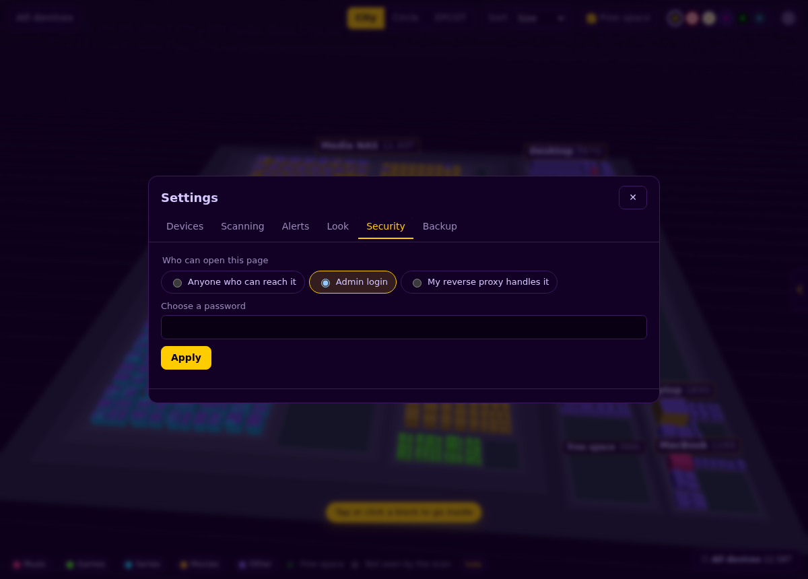

# Security

D.C. O'HAIR logs in to your machines and lists their files, so it should be careful. Here's what it does, what it never does, and how to lock it down.

- [What it touches](#what-it-touches)
- [No stored passwords](#no-stored-passwords)
- [The hub's SSH key, and least privilege on devices](#the-hubs-ssh-key-and-least-privilege-on-devices)
- [Who can open the page](#who-can-open-the-page)
- [Reverse proxy examples](#reverse-proxy-examples)
- [What the hub does to protect itself](#what-the-hub-does-to-protect-itself)
- [Checklist](#checklist)
- [Reporting a problem](#reporting-a-problem)

---

## What it touches

**On your devices, it only reads.** The scanner (`agent.py`) lists folders and reads each file's size, date, and link count. It doesn't open or read file contents, and it never creates, changes, moves or deletes anything. It's one Python file that the hub sends over SSH (`ssh device python3 -`) each time. Nothing is installed, and nothing stays behind.

**On the hub**, it writes only its own files: `devices.yml` (and a `.bak` of the previous version) and the `data/` folder.

**What it learns:** the names, sizes and dates of the files and folders it scans, and each drive's used, free and total space. That's enough to reveal a lot about what's on your disks, so treat the page and `data/` as private.

---

## No stored passwords

The hub never stores a device password. There are three ways for it to log in:

1. **SSH keys** (recommended): the hub's own key, or the keys its user already has.
2. **password_cmd**: a command the hub runs at scan time that *prints* the password, such as a password-manager lookup like `pass show nas/ssh`. The output goes to `sshpass` through an environment variable (never on a command line, where other users could see it in `ps`). It's never written to disk, a log, or the page.
3. **This machine**: no login at all, because the hub scans its own drives.
4. **Push agent**: the hub never logs in. The device runs `dc-push.py` and signs each report with its own enrollment token. The hub keeps only a SHA-256 hash of the token, and shows the token once, inside the install command. On the device, the token sits in `~/.dc-ohair/push.json`, readable only by that user. Revoke a token in **Settings → Security** and its reports are refused at once. Making a new command replaces the old token.

A push agent downloads the hub's current `agent.py` before every run, so a device trusts its hub the same way an SSH-scanned device does. Over plain HTTP on your LAN, the token travels unencrypted; set `hub.public_url` to an HTTPS address if devices report over a network you don't trust.

The admin password for the page (if you turn one on) is stored only as an **argon2** hash. If argon2-cffi isn't installed, a **scrypt** hash is used instead.

### password_cmd is a command, so guard it

Whoever can set a device's `password_cmd` can make the hub run a command. That's why:

- With the page login **off**, `password_cmd` can only be changed from a browser on the hub itself (or in the config file). Requests from anywhere else are refused.
- With a login on, only logged-in admins can change it.

If your hub can be reached by anyone but you, turn on a login.

---

## The hub's SSH key, and least privilege on devices

The hub makes its own ed25519 key the first time it needs one, at `~/.config/dc-ohair/ssh/id_ed25519` (in Docker, `/data/ssh/id_ed25519`), outside the code folder so it can never be committed by accident. Set `DC_SSH_DIR` to put it elsewhere. The folder is `0700` and the key is `0600`. Back it up like any other key.

You can add that key to a device in two ways (Settings shows both, ready to copy).

**ssh-copy-id** adds the key normally. The key can do anything that user can do.

**The restricted line** is safer. It adds the key with a *forced command* and no extras:

```text
command="python3 -c \"…\" $SSH_ORIGINAL_COMMAND",no-port-forwarding,no-X11-forwarding,no-agent-forwarding,no-pty ssh-ed25519 AAAA… dc-ohair@hub
```

The forced command reads the script the hub sends, checks its **sha256** against the exact `agent.py` your hub had when it made the line, and runs it only if it matches. So even if someone stole the hub's key, it would only run D.C. O'HAIR's read-only scanner on that device: no shell, no terminal, no tunnels. After you update D.C. O'HAIR, replace the line with the new one from Settings.

**Use the least access that works.** Scan as a normal user who can read your media folders, rather than root. Anything that user can't read shows up as "Not seen by the scan", and the totals still come from the drive itself. Use root only on appliances where root is the only user, like LibreELEC.

### Host keys

The hub trusts a device's SSH host key the first time it connects (`StrictHostKeyChecking=accept-new`), and from then on refuses to connect if that key changes. When it refuses, the page tells you. That's expected after a reinstall, or if the machine booted into a different OS. If neither happened, find out why before you tell the hub to forget the old key with `ssh-keygen -R host`.

---

## Who can open the page

Choose in **Settings → Security**:

<p align="center"></p>

| Mode | Use it when |
|---|---|
| **Anyone who can reach it** (`auth: "off"`, the default) | Only you can reach the hub: it's on your own machine, or on a home network you trust. If the hub listens on the network with no login, Settings shows a warning. |
| **Admin login** (`auth: password`) | Other people can reach the page. You log in once per browser, and it lasts 30 days. |
| **My reverse proxy handles it** (`auth: proxy`) | You already sign in to your sites through a proxy (Authelia, Authentik, oauth2-proxy, VoidAuth and the like). |

When a login is on, every `/api/` call except `/api/me` needs it. The page's own files (HTML, scripts, styles) still load, and then the page asks you to log in before it shows any data.

### Admin login details

- The password must be at least 8 characters. Set it in Settings, or in a terminal with `python3 hub.py --set-password`.
- Logging in sets a cookie that's `HttpOnly` and `SameSite=Strict`, and also `Secure` when the request came over HTTPS through a proxy (`X-Forwarded-Proto: https`).
- Sessions are kept in `data/sessions.json` as hashes only, and last 30 days. Changing the password logs everyone out.
- Wrong passwords are rate-limited to 8 tries per 10 minutes per address.

### Proxy mode details

The hub lets a request in when **both** of these are true:

- it comes **from** one of `hub.trusted_proxies` (default `127.0.0.1` and `::1`)
- it carries the `hub.proxy_user_header` header (default `Remote-User`)

So:

- Make sure **every** route to the hub goes through your proxy's auth check.
- Set `hub.bind: 127.0.0.1` when the proxy runs on the same machine, so nobody can skip the proxy and talk to port 7171 directly.
- Only list proxies you control in `trusted_proxies`.

---

## Reverse proxy examples

### Caddy + Authelia

```caddyfile
disks.example.com {
    forward_auth authelia:9091 {
        uri /api/authz/forward-auth
        copy_headers Remote-User Remote-Groups Remote-Email Remote-Name
    }
    reverse_proxy 127.0.0.1:7171
}
```

In `devices.yml`:

```yaml
hub:
  bind: 127.0.0.1
  auth: proxy
  trusted_proxies: ["127.0.0.1", "::1"]
  proxy_user_header: Remote-User
```

### Caddy + oauth2-proxy

```caddyfile
disks.example.com {
    handle /oauth2/* {
        reverse_proxy oauth2-proxy:4180
    }
    handle {
        forward_auth oauth2-proxy:4180 {
            uri /oauth2/auth
            copy_headers X-Auth-Request-User
            @bad status 401
            handle_response @bad {
                redir * /oauth2/sign_in?rd={scheme}://{host}{uri}
            }
        }
        reverse_proxy 127.0.0.1:7171
    }
}
```

and set `proxy_user_header: X-Auth-Request-User`.

### VoidAuth, Authentik and others

They work the same way: point Caddy's `forward_auth` (or nginx's `auth_request`) at the forward-auth endpoint from their docs, pass the logged-in user's name on in a header, and set `proxy_user_header` to that header's name.

### Running Docker behind a proxy

Publish the port on loopback only, so the proxy is the only way in:

```yaml
ports:
  - "127.0.0.1:7171:7171"
```

The proxy then reaches the container from the Docker bridge, so add that address (for example `172.17.0.1`) to `trusted_proxies`, or put the proxy in the same compose network and trust its address.

---

## Drive health and root

Built-in SMART runs `smartctl`, which needs root. If the scanning user isn't root, the scanner uses `sudo -n smartctl`, so it never waits at a password prompt. Allow exactly that and nothing else with a sudoers rule (`sudo visudo -f /etc/sudoers.d/dc-ohair`):

```
scanuser ALL=(root) NOPASSWD: /usr/sbin/smartctl
```

Use the real user name and the path from `command -v smartctl`. Without the rule, health shows as *Unknown* with a note saying why, and scanning carries on as normal. Pairing with Scrutiny needs nothing on the devices: the hub reads Scrutiny's `/api/summary` (with a token from `scrutiny_token_cmd` if your Scrutiny sits behind a login).

## Finding devices

**Find devices on my network** runs only when someone presses it. It tries a TCP connection to ports 22, 445, 548, 5000 and 5001 on each address of the hub's own network (or a private network you type in, at most a /22), reads the SSH greeting line if there is one, and asks for names over reverse DNS and multicast DNS. It never logs in and never sends anything else. It refuses public address ranges, and the hub limits it to a few searches a minute.

## What the hub does to protect itself

- **Writes need a custom header.** Every `POST` and `PUT` must send `X-DC: 1`. A web page on another site can't add that header without CORS permission, and the hub never grants any, so other sites can't make your browser change settings or start scans.
- **No CORS** at all, and `X-Frame-Options: SAMEORIGIN` so the page can't be framed by other sites.
- `X-Content-Type-Options: nosniff` and `Referrer-Policy: no-referrer` on every response.
- **No directory listings**, and file paths are checked so nothing outside `web/` is served.
- **Login settings can't be changed by a normal settings save or an import.** They only change through Security, by someone already allowed in.
- **Probes are rate-limited.** "Test connection" and "Find drives" allow 30 tries a minute per address.
- **`devices.yml` is saved as `0600`**, so only the hub's user can read it.
- **Demo mode** (`--demo`) never scans, never runs commands, and never saves anything.

---

## Checklist

- [ ] The hub is only reachable by you, **or** a login is on (admin login or proxy).
- [ ] With a proxy: `bind: 127.0.0.1`, and `trusted_proxies` lists only your proxy.
- [ ] Devices use **keys**, preferably the restricted `authorized_keys` line.
- [ ] Devices are scanned as a normal user that can read your media, not as root (where there's a choice).
- [ ] `data/` and `devices.yml` are private, and backed up.
- [ ] You've restarted the hub after updating, and refreshed any restricted `authorized_keys` lines.

---

## Reporting a problem

Please don't open a public issue for a security problem. See [SECURITY.md](../SECURITY.md).
